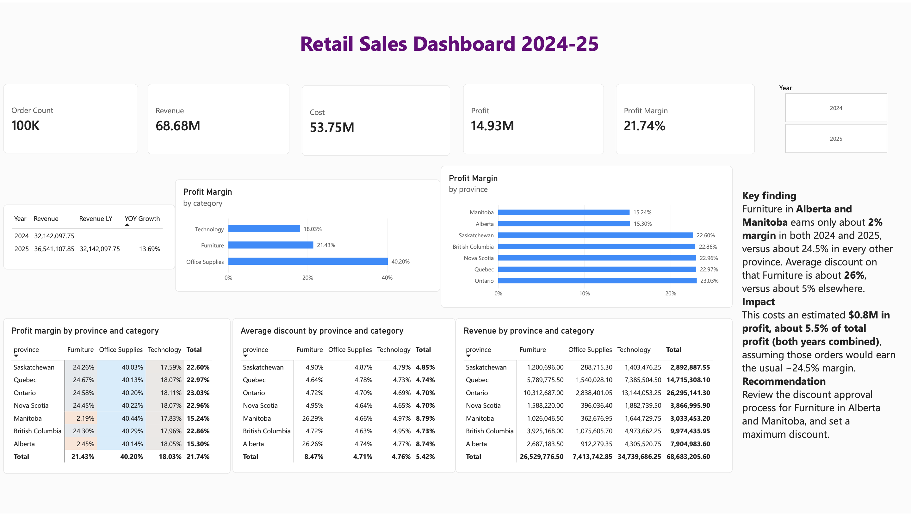

# Retail Sales Dashboard (Power BI)

A Power BI dashboard on two years of retail sales that finds where profit is being lost.

## Problem
The company-wide profit margin looks healthy at **21.74%**, but an average can hide a problem inside it. The question: **where is profit being lost, and why?**

## Data
**Synthetic practice data** generated for this project. It is not real company data, and the patterns in it were built in so there would be something to find. What this project shows is the method.

| Table | Rows | What it holds |
|---|---|---|
| `fact_sales` | 100,000 | one row per order line: date, customer, product, quantity, discount, unit price (2024 to 2025) |
| `dim_customers` | 2,500 | customer, segment, city, province (7 provinces) |
| `dim_products` | 24 | product, category (3 categories), list price, unit cost |

## Method
- **Data model:** star schema in Power BI with `fact_sales` joined many-to-one to `dim_customers`, `dim_products` and a `DimDate` calendar table. All relationships are single-direction.
- **DAX measures:**
  - `Revenue` = quantity x unit price x (1 - discount), using `SUMX`
  - `Cost` = quantity x unit cost, using `SUMX` and `RELATED`
  - `Profit`, `Profit Margin %` (with `DIVIDE`)
  - `Revenue LY` (`CALCULATE` + `SAMEPERIODLASTYEAR`) and `YOY Growth`
  - `Order Count` (`COUNTROWS`) and `Avg Discount`
- **Checks:** revenue of 68.68M and cost of 53.75M matched reference totals; 2025 growth over 2024 is 13.69%.

## How the problem was found
1. Margin by **category** showed nothing alarming (Furniture 21.4%, close to the average).
2. Margin by **province** showed Alberta (15.30%) and Manitoba (15.24%) about 7.5 points below the other provinces (22.6% to 23.0%).
3. A **province x category matrix** showed the real cause: it is one category in two provinces. **Furniture earns about 2% margin in Alberta and Manitoba, versus about 24.5% everywhere else.**
4. A second matrix of **average discount** explained why: Furniture in those two provinces is discounted about **26%**, versus about **5%** elsewhere.
5. A **Year slicer** showed the pattern in both 2024 and 2025, so it is ongoing and not a one-off.

## Finding
Over-discounting Furniture in Alberta and Manitoba costs an estimated **$0.8M in profit, about 5.5% of total profit (both years combined)**.

Calculation: Furniture revenue in the two provinces is 3.71M (Alberta 2.69M + Manitoba 1.03M). The margin gap is about 22 points (24.5% normal minus about 2.3% actual). 3.71M x 0.22 is about 0.82M. This assumes those orders would otherwise earn the usual margin.

## Recommendation
Review the discount approval process for Furniture in Alberta and Manitoba and set a maximum discount.

## Files
| File | What it is |
|---|---|
| `retail_sales_dashboard.pdf` | the finished dashboard, exported from Power BI |
| `screenshots/` | dashboard image |
| `data/` | the three CSV files the model is built on |
| `retail_sales.xlsx` | the same data as one Excel workbook |

The `.pbix` file is not included. It was built in Power BI in the browser, which does not export `.pbix`.
